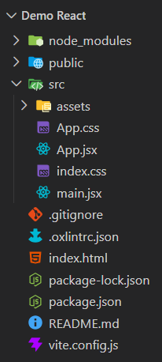
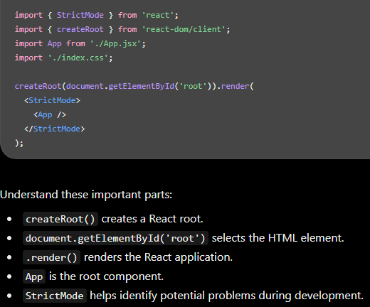

# 
 INTRODUCTION

### **WHAT IS REACT JS ?**  
Open source Js **library**,  

**Library**: You call function, like a toolbox you pick tools when needed    
**Framework**: It decides when your code runs, You follow its rules and structure

Developed by Facebook SDE **Jordan Walke** (2013),  
Got Open Sourced in 2015.   

React Native easily can be learnt after - for Mobile Apps

---

**HOW IT WORKS?**  
Creates virtual DOM  
Only changes what needs to be changed,  
DOM used to refresh the whole webpage.  

---

React Project Essentials -
- **Vite** ?  
Recommended in Offical documentation  
Super fast dev server & Build tool
- **NodeJs** - LTS (Long term support)
- Npm | Bun can also be used instead of npm as 29x faster

---
   
### Our First React App

   Go to https://vite.dev/guide/ for steps
1. Open terminal and go to folder location.
2. `npm create vite@latest`
3. Will ask to name project,  
Select framework - react,  
Select variant - Javascript
4. `cd ProjectName` 
5. `npm install`  
All above steps will add needed files for the App.
6. `npm run dev`

Your project should now run on **localhost : 5173** (Vite’s default port).  
5173 ~ VITE

We can use online react too, Official Site  
https://stackblitz.com/edit/vitejs-vite-jzwmmfrr?file=index.html&terminal=dev

---

### 
 WorkFlow

index.html -> main.jsx -> App.jsx -> Other linked Components

1. **Node_Modules Folder**  
2. **Public Folder**  
   All statics assets - images/videos
3. **Src Folder**   
   Contains all source files.  
   3.1. Assets Folder ~ similar work like Public but restrictions  
   3.2. App.jsx - Basic Layout, Goes to Main.jsx file  
   3.3. Main.jsx - Imports App.jsx, links index.html  
   3.4. App.css  
   3.5. Index.css
4. **.gitignore**  
   If you don't want to add folder as a git repo
6. **index.html**  
   Main file where react app is loaded, **entry point** of browser
7. **package.json**  
   Configuration of libraries, dependancies
8. **package-lock.json**  
   Nested and more details comparison to package.json
9. **vite.config.js**
10. **eslint.config.js**

---

## main.jsx
